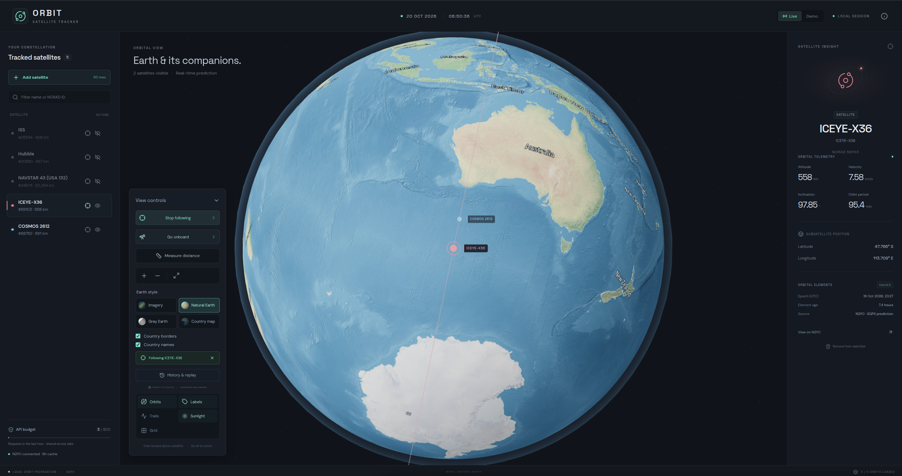

# Orbit — Satellite Tracker

Explore Earth and its satellites in 3D. **Orbit** is a local satellite tracker built with React, TypeScript and Three.js, using N2YO orbital elements and local SGP4/SDP4 propagation for smooth motion without constant API polling.



*Natural Earth map style with country labels and Earth-centered satellite following. The screenshot shows an example session, not current satellite positions.*

## Features

- **Track up to 50 satellites** together. Search the bundled catalogue by name, partial name or NORAD ID; enter other NORAD IDs directly.
- **Three camera modes:** freely orbit Earth, follow a satellite from above, or go onboard and look around from its position.
- **Measure satellite separation** in 3D, including altitude difference and which satellite is higher. Display an optional connecting line and geometric Earth-obstruction indicator.
- **Save and rewind history.** SQLite archives orbital snapshots for UTC seeking, pause, reverse playback and speeds up to 60×.
- **Four Earth styles:** NASA imagery, Natural Earth, Gray Earth and a dark country map, with optional country borders and names.
- **Customize the globe** with orbit paths, labels, trails, sunlight and a geographic grid. Minimize the controls to clear the view.
- **Keep API use low** with persistent caching, request deduplication, rate limiting and local orbital prediction.
- **Try it without a key** using the bundled demo snapshot.

## Quick start

Requires **Node.js 24 or later**, npm and a browser with WebGL / hardware acceleration enabled.

```sh
git clone https://github.com/JSJFIN/sattracker.git
cd sattracker
npm ci
```

For a new installation, copy `.env.example` to `.env`. **Keep your existing `.env` when updating.** On Linux or macOS:

```sh
cp -n .env.example .env
chmod 600 .env
```

On Windows, copy the file manually if `.env` does not already exist.

For live tracking, get a key from [N2YO](https://www.n2yo.com/api/) and set `N2YO_API_KEY` in `.env`. Leave it empty to start in Demo mode.

```sh
npm run dev
```

Open **http://127.0.0.1:5174**. The local API runs at **http://127.0.0.1:3001**. Both servers bind to loopback only. If this project is already running, open the existing session instead of starting another copy.

The backend picks up API-key changes automatically. Restart it after changing other server settings. Demo mode uses a fixed **19 October 2026** snapshot and is explicitly labelled; it does not show current positions.

## Using the tracker

| Action | Controls |
| --- | --- |
| Add satellites | **Add satellite**, then search by name or NORAD ID |
| Inspect a satellite | Click its marker or its watchlist row |
| Show, hide or remove | Use the eye or remove button in the watchlist |
| Rotate and zoom | Drag the globe; scroll or use `+` / `−` |
| Follow from above | Click the row's crosshair or **Follow**; click again to stop |
| Ride onboard | Select a satellite, then choose **Go onboard** |
| Look around onboard | Drag with mouse/touch, or focus the view and use arrow keys |
| Change onboard gaze | **Look ahead**, **Earth** or **Space**; scroll changes field of view |
| Leave onboard mode | **Return to Earth view**, **Reset camera**, or Escape while the view has focus |
| Measure separation | **Measure distance**, then choose satellites A and B |
| Change Earth appearance | **Earth style**, **Country borders** and **Country names** |
| Rewind | **History & replay**, then scrub, enter a UTC time or choose a playback speed |
| Clear the view | Click the **View controls** heading to minimize or expand it |

View controls stay along the **left edge of the orbital view**. The watchlist, Earth appearance and minimized-panel preference are saved in this browser.

Follow mode keeps Earth centered and places the viewpoint above the selected satellite. Onboard mode rides at the satellite's predicted position, with an orbit-relative viewing frame. Its own marker and path are hidden for visibility. This is a simulated viewpoint; orbital elements do not provide the spacecraft's actual attitude.

Distance measurements use orbital states independently of visual marker smoothing. The panel shows straight-line separation, altitude difference and the measurement's UTC time. **Orbit data** shows element epochs and fetch times. Hidden satellites can still be measured numerically; show both to draw the connection.

## How motion and API limits work

The backend requests **TLE orbital elements**, rather than polling N2YO positions for animation. A browser worker propagates the orbits twice per second; cubic Hermite interpolation produces smooth motion between those calculations, including during reverse and accelerated replay.

| Protection | Default behavior |
| --- | --- |
| Persistent TLE cache | Reuse each element set for 6 hours |
| Shared rolling budget | At most 800 attempted upstream requests per hour |
| Request spacing | At least 1.1 seconds between upstream requests |
| Concurrent requests | Deduplicated for the same satellite |
| Upstream rate limit | Pause requests for an hour on HTTP 429 |
| Other failures | Back off and retain stale cached elements when available |

[N2YO currently documents 1,000 TLE transactions per hour](https://www.n2yo.com/api/); Orbit uses a lower default budget. With 50 satellites and a six-hour refresh interval, continuous use needs roughly **200 TLE requests per day**, excluding additional cache misses. Search, rendering, camera changes, distance measurements and replay do not create extra N2YO requests.

The backend also monitors N2YO's reported usage. Its local counter cannot fully account for another application using the same key.

## History and local data

Orbital data is stored in **`.data/tracker.sqlite`**. Every successful N2YO fetch appends a timestamped snapshot, even when the TLE is unchanged. Previous snapshots and successful source data are retained; credentials and upstream request URLs are not archived.

Replay uses each satellite's **last snapshot fetched at or before the selected time**. Satellites without a snapshot at that time are hidden. It switches element sets as playback crosses snapshot boundaries and never substitutes a later element set for missing historical data.

History reconstructs predicted positions from saved orbital elements. Collection happens when the running app fetches data; leaving only the backend running does not schedule unattended collection. The archive has no automatic expiry and cannot backfill history from before the first saved fetch.

To back up your history, stop the local server and copy `.data/`. Database files, caches and local `docs/` notes are excluded from Git.

## Configuration and key handling

Set these in `.env`, or supply them as server environment variables:

| Variable | Default | Purpose |
| --- | --- | --- |
| `N2YO_API_KEY` | Empty | Server-only key; empty starts Demo mode |
| `PORT` | `3001` | Local API / production-server port, 1024–65535 |
| `TLE_REFRESH_HOURS` | `6` | TLE cache lifetime, 1–24 hours |
| `N2YO_HOURLY_BUDGET` | `800` | Maximum attempted upstream requests per rolling hour, 1–900 |

The API key stays in the local backend. **Never prefix it with `VITE_`**, paste it into an issue or screenshot, or commit a populated environment file. `.env` and its local variants are ignored; `.env.example` contains no credential. Development file serving also blocks environment files, Git internals, local archives, caches and notes.

The production server serves only the built `dist/` directory. This project is designed for local use and does not include authentication for an internet-facing deployment. Fonts load from Google Fonts when available, with local system-font fallbacks.

## Accuracy

Positions, distances and close approaches are **predictions from orbital elements**. Their accuracy depends on element age, tracking quality and maneuvers that may not yet be reflected in the data. Decimal places in a distance readout are not a measurement-accuracy guarantee.

The globe uses a common Earth-distance scale and enlarged satellite markers. Line-of-sight obstruction uses the rendered Earth sphere. This app does not receive live spacecraft position or attitude telemetry, and public TLE data cannot establish meter-scale proximity for a maneuvering pair without more precise tracking information.

## Development

```sh
npm test
npm run build
```

Tests cover API budgets and deduplication, error handling, history migration and snapshot boundaries, orbital reference cases, interpolation through 60× playback, camera geometry and onboard controls, and satellite-distance calculations checked against independent SGP4 reference results. N2YO test responses are mocked; the suite spends no real API requests.

After building, run the app and API together with:

```sh
npm start
```

Open **http://127.0.0.1:3001**, or the configured `PORT`. Stop the development API first if it already uses that port.

Optional maintenance commands:

| Command | Purpose |
| --- | --- |
| `npm run catalog:update` | Refresh the bundled CelesTrak name catalogue; run at most once daily, then restart the API |
| `npm run assets:earth` | Rebuild map textures from public-domain Natural Earth data; requires `unzip` |

These commands download external data. Earth textures and the catalogue are already bundled, so neither is required for normal startup. The catalogue is a dated active-satellite snapshot, supplemented with archived names; numeric ID entry supports objects outside it.

<details>
<summary>Local history API</summary>

- `GET /api/history?ids=25544,20580` — available ranges and snapshot counts; omit `ids` to list all archived satellites.
- `GET /api/history/elements?ids=25544,20580&at=<unix-milliseconds>` — as-of orbital elements, missing IDs and the result's validity interval.

</details>

<details>
<summary>Source layout</summary>

| Path | Purpose |
| --- | --- |
| `src/App.tsx` | Watchlist, controls and telemetry |
| `src/Scene.tsx`, `src/OnboardCamera.tsx` | Globe, markers and camera modes |
| `src/engine.worker.ts` | Local orbital propagation |
| `src/Timeline.tsx`, `src/useArchive.ts` | History playback |
| `src/DistanceTool.tsx`, `src/DistanceMeasurement.tsx` | Distance controls and connection rendering |
| `shared/` | Orbital coordinates, clocks, camera geometry and distance calculations |
| `server/n2yo.ts`, `server/store.ts` | Upstream requests, SQLite cache and archive |

</details>

## Credits

Earth imagery: **NASA Earth Observatory**. Map styles and geographic overlays: **Natural Earth**, public domain. Satellite name catalogue and demo elements: **CelesTrak**. Live orbital elements: **N2YO**.

See [ASSETS.md](ASSETS.md) for data sources, asset credits and third-party terms.
